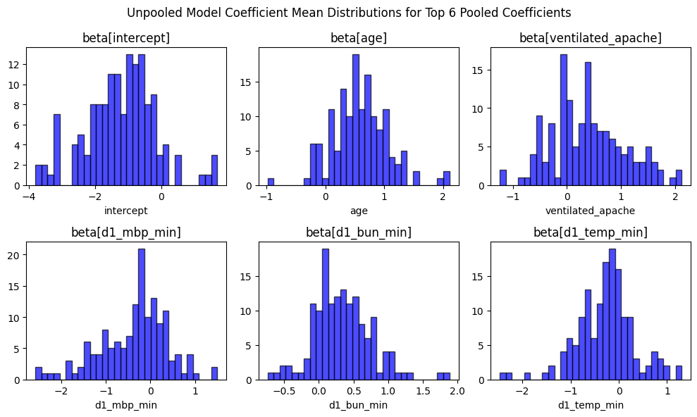
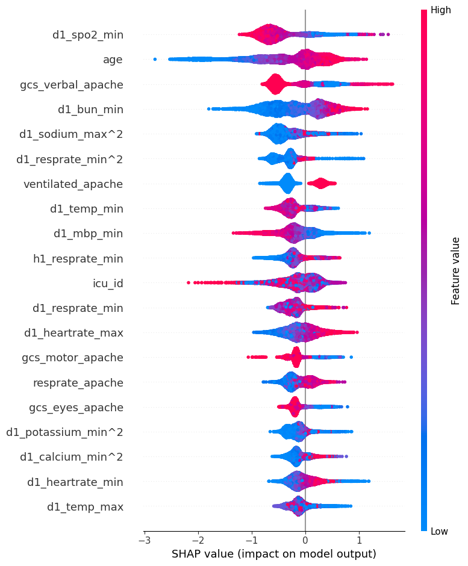

# Predicting ICU Mortality from the First 24 Hours

Can a small set of vitals and labs from a patient's first day in the ICU tell you who is likely to die in hospital? And does it matter *which* hospital they're in?

We used 91,713 ICU stays from 147 hospitals ([WiDS Datathon 2020](https://www.kaggle.com/competitions/widsdatathon2020)), cut 186 raw columns down to 25 with Lasso, and compared seven models, from logistic regression through LightGBM to hierarchical Bayesian models.

Final project for Harvard CS1090a (Fall 2025), by Hoi, Sammy and Andrew.

## Results

Held-out test set (18,343 patients, 8.6% mortality):

| Model | F1 | AUC | Notes |
|---|---|---|---|
| **Bayesian logistic, pooled** | **0.452** | 0.862 | Threshold 0.79, picked on validation |
| **LightGBM (tuned)** | **0.454** | **0.875** | Threshold 0.5 |
| Logistic regression, L2 (λ ≈ 5×10⁶) | 0.425 | 0.846 | |
| Logistic regression, unregularized | 0.394 | 0.867 | Memorized hospital IDs |
| Decision tree (grid-searched) | 0.354 | 0.745 | |
| Bayesian, partially pooled | 0.428* | 0.824* | |
| Bayesian, unpooled | 0.411* | 0.796* | |

<sub>* Validation set. The hierarchical models were not re-scored on test.</sub>

We chose F1 because accuracy is useless here: predicting "survives" for everyone scores 91%.

## Three things we learned

**1. Hospital identity is a trap.** Mortality rates vary a lot between hospitals, so we expected per-hospital models to help. They didn't. Unregularized logistic regression put its 75 largest coefficients on `hospital_id` dummies, effectively building a hospital lookup table. The unpooled Bayesian model (independent coefficients per hospital) did worse than pooling everyone together, and partial pooling only clawed back part of the gap.

<p align="center"></p>

<sub>Per-hospital coefficients from the unpooled model. Mechanical ventilation comes out *protective* at some hospitals. That's noise from small samples, not medicine.</sub>

Our read: a deteriorating patient looks much the same in every ICU, and the physiology carries the signal.

**2. "Goldilocks" vitals need a squared term.** Body temperature, sodium and heart rate are dangerous at both ends. Before running Lasso we added x² for 25 standardized vitals and labs, and 11 of the 25 features Lasso kept were squared terms. In the SHAP plot for LightGBM, `d1_sodium_max^2` and `d1_resprate_min^2` rank above several raw vitals.

<p align="center"></p>

**3. A 36-coefficient model matches gradient boosting on F1.** The pooled Bayesian model ties LightGBM on F1, and every coefficient comes with a credible interval. The biggest effects (standardized log-odds): age +0.57, ventilated +0.54, BUN +0.31, minimum mean BP −0.35, and the GCS motor/eye scores around −0.2. LightGBM still ranks patients better (AUC 0.875 vs 0.862). If you only care about ranking risk, use the trees. If a clinician has to trust the output, the pooled model is easier to defend.

## Pipeline

```
training_v2.csv (91,713 × 186)
  → drop columns >25% missing                          186 → 112
  → missingness flags, IterativeImputer / mode
  → standardize, add x² for 25 Goldilocks features
  → L1 logistic path (SGD, 30 λ values, parallel)      → 25 features
  → 64/16/20 stratified split
  → SMOTENC on train only (val/test keep 8.6% deaths)
  → models
```

## Repo layout

```
notebooks/
  01_eda.ipynb             missingness, imbalance, collinearity, VIF
  02_preprocessing.ipynb   builds the train/val/test splits
  03_modeling.ipynb        the main report: Lasso, all models, evaluation
src/icu_mortality/
  features.py              SquaredFeaturesOnly transformer, Goldilocks list
  evaluation.py            threshold sweep, F1-optimal cutoff
  bayes.py                 pooled / unpooled / partially pooled PyMC models
tests/                     pytest; includes a check of the reported numbers
reports/                   milestone PDF and figures
```

## Running it

```bash
python -m venv .venv && source .venv/bin/activate
pip install -r requirements.txt
pytest                     # 15 unit tests run anywhere; 2 more need data/
jupyter lab notebooks/
```

See [`data/README.md`](data/README.md) for where to get the data. With `data/` in place, `tests/test_saved_results.py` reloads the saved posterior and checks that the pooled model's validation and test scores match the table above.

## What we'd do differently

Things we'd fix with more time. Listed because they affect how much to trust the numbers:

- **Feature selection saw the test set.** The Lasso λ and the logistic-regression C were chosen by F1 on the same 20% split that's later used as the test set. The test scores are probably a little optimistic. The fix is to tune on validation only.
- **Imputation was fit before the split.** It's unsupervised, so the leak is mild, but it's still a leak.
- **The Bayesian threshold was tuned and the others weren't.** We report the pooled model at its validation-tuned cutoff and the rest at 0.5. Tuning every model's threshold on validation would make the comparison fairer, and LightGBM would probably gain the most.
- **`icu_id` went into LightGBM as a number.** It shows up in the SHAP plot, which means the model is splitting on an arbitrary ID. It should be categorical, or dropped.
- **The partially pooled model didn't converge.** It ran 300 draws with 100 tuning steps, and 5% of its parameters have r̂ > 1.01 (the worst is 1.29). Some of its gap with the pooled model may come from under-sampling rather than from the model itself.
